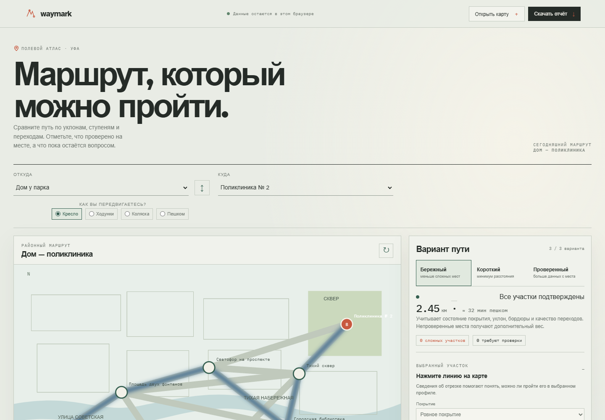
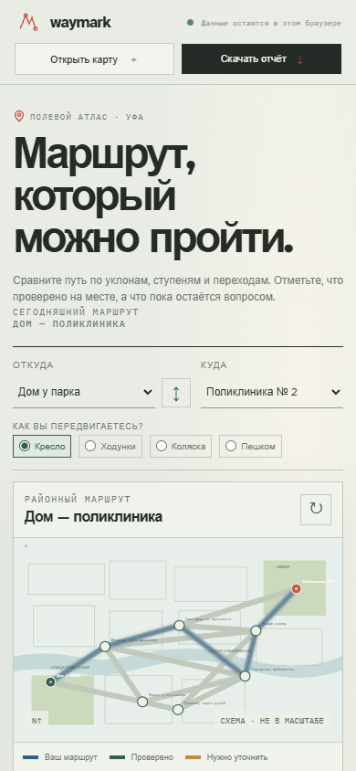

# Waymark

## English

**A route should be more than a line on a map.** Waymark compares a small street network using the needs that change whether a trip is possible: steps, curb height, surface, slope, crossings, lighting and field verification. People can add a note to a segment and export a route report or a spreadsheet of observations.

The built-in Ufa-like map is an **illustrative sample**, not official street, navigation or accessibility data. Reports carry that warning with them. Use Waymark to explore route trade-offs and organize field checks; verify conditions on site before relying on a route.

## Try it

Open `index.html` in a recent browser. No build step, account, server or network access is required for the planner itself. Changes stay in local browser storage. Google Fonts are an optional visual enhancement; system fonts are used when offline.

1. Choose a start, destination and mobility profile.
2. Compare balanced, shortest and more thoroughly checked routes.
3. Select a street segment on the map to record its surface, slope, curb, crossing, lighting, verification and a note.
4. Download a route report (JSON), segment register (CSV), or a local map you can reopen later.

## Why this project exists

City accessibility data is often incomplete or outdated. Waymark makes uncertainty visible instead of silently treating an unverified sidewalk as safe. Its useful output is a shareable list of exact segments to check, with enough context for a resident, community group or city team to discuss what needs fixing.

## Design and privacy

The visual idea is a **field atlas**: a quiet street-map palette with a distinct route line and separate marks for checked paths and questions to investigate. This makes confidence visible without turning accessibility into a score or decorating the interface with generic dashboards. There is no account or analytics; route choices and notes remain in this browser unless you export them.

## Русский

**Маршрут — это больше, чем линия на карте.** Waymark сравнивает варианты пути с учётом того, от чего зависит доступность прогулки: ступеней, высоты бордюра, покрытия, уклона, переходов, освещения и наличия полевой проверки. На отрезках можно оставить заметки и выгрузить отчёт по маршруту или таблицу наблюдений.

Встроенная схема в духе Уфы — **иллюстративный образец**, а не официальная карта улиц, навигации или доступности. Это предупреждение включается в экспорт. Waymark помогает сравнивать компромиссы и организовать проверку на месте; перед поездкой состояние маршрута нужно проверить самостоятельно.

Откройте `index.html` в современном браузере. Сборка, учётная запись, сервер и сетевое подключение для работы планировщика не нужны. Изменения сохраняются только в локальном хранилище браузера. Шрифты Google — необязательное оформление; без сети браузер использует системные шрифты.

1. Выберите начальную точку, место назначения и профиль передвижения.
2. Сравните сбалансированный, кратчайший и более тщательно проверенный маршруты.
3. Выберите отрезок улицы на карте и укажите покрытие, уклон, бордюр, переход, освещение, проверку и заметку.
4. Скачайте отчёт по маршруту (JSON), таблицу отрезков (CSV) или локальную карту для последующего открытия.

### GEO и SEO

В `index.html` указаны русский язык, описание и поисковые метаданные, Open Graph и географические метки Уфы, Республика Башкортостан (RU-BA). Геометки описывают регион примера и не означают наличие официального картографического источника.
